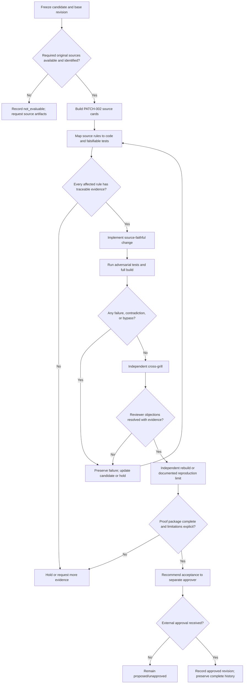

# Change

Add a self-contained `hyperskill/axis-integrity/SKILL.md` defining the security model, source-grounded implementation process, and evidence-bearing proof-of-work record for the Axis subsystem. The skill governs proposed changes to `diffusion-core/src/axis.rs` and its related refusal, ticket-evidence, organization-rank, tests, and build artifacts. It does not replace the original source rules, PATCH-001's scientific-method process, PATCH-002's digital-artifact records, or the system's separate authorization and ticket-governance rules.

Axis is a rule-enforcement boundary, not merely a collection of enums. Its purpose is to make prohibited operations refuse in a way callers cannot silently reinterpret as success. A change is not accepted because it compiles, because a local test passes, because an agent says it followed the design, or because a digest exists. It must have source-grounded claims, explicit invariants, adversarial tests, reproducible execution records, independent challenge, and an approval decision separate from the candidate's own self-assessment.

In this patch, **proof-of-work** means a traceable package of work products and verification evidence demonstrating what was inspected, implemented, tested, challenged, and reproduced. It does **not** mean cryptocurrency mining, an arbitrary computational puzzle, a raw count of operations, or a numeric score. Evidence of work is not proof of universal correctness. A hash is an integrity fingerprint, not by itself proof of origin, authenticity, authorization, or correctness.

This patch is proposed and non-mutating. The Rust excerpt supplied with the request is a design input, not an independently built or repository-verified artifact. Any source rule whose original referenced file has not been inspected must remain `not_evaluable`; do not invent the original source's contents, its digest, or a successful verification result.

# Proposed standalone `SKILL.md`

# Axis Integrity and Proof-of-Work

## 1. Purpose and boundaries

Use this skill whenever an agent investigates, implements, changes, ports, verifies, or proposes to certify the Axis subsystem. Axis encodes distinctions and prohibitions that other subsystems rely on. It must not be treated as a convenience layer that can turn invalid state into a warning, flatten a structured gate into a status, infer missing values, or reinterpret a ladder as a score.

The central operating principle is:

> **A rule is not enforced merely because it is documented. The implementation must make the forbidden path fail, and the verification record must show exactly which source rule and test support that conclusion.**

The skill covers:

- provenance and authority for every rule implemented by Axis;
- the distinct type and token domains of each ladder;
- non-interchangeability, non-quantification, threshold certification, gate predicates, transition invariants, token qualification, and coverage completeness;
- safe interfaces at which callers consume Axis results;
- evidence records for source review, tests, builds, mutations, counterexamples, and independent reproduction;
- review of failures, missing source material, ambiguous rules, and unresolved design questions;
- explicit candidate disposition and preservation of earlier evidence.

The skill does **not** independently define or replace the underlying rules in `AGENTS.md`, the source Python model, `ala-system`'s `support.ts`, `ala-cities::gov::Evidence`, `EvidenceOrigin`, organization documents, or the general refusal and ticket systems. It must use PATCH-002 records for digital source artifacts and PATCH-001's scientific-method loop for design claims and unresolved hypotheses.

### 1.1 Scope boundary with PATCH-001 and PATCH-002

- **PATCH-001 owns the inquiry method:** question and scope, hypotheses, predictions, evidence map, conditional diagram, falsification, reproduction, cross-grill, and candidate disposition.
- **PATCH-002 owns the digital-source record:** exact artifact identity and version, locator, retrieval/access state, digest, method summary, limitations, claims supported, and reproduction status.
- **PATCH-062 owns the Axis-specific integrity contract:** how the source-backed rules must be represented and enforced in Axis, and what implementation evidence is required before the candidate may be recommended for acceptance.
- The actual approval authority remains external to this skill. An agent cannot self-approve its implementation, convert a test result into an organizational grant, or promote the candidate by declaring its proof package complete.

## 2. Definitions: rule, ladder, gate, refusal, and proof-of-work

### 2.1 Rule

A `rule_id` is a stable identifier for one prohibition, invariant, type distinction, or transition requirement. A rule must identify its original source and exact locator. A paraphrase in a derived Rust module does not become independent authority for the rule it rederives.

### 2.2 Ladder

A ladder is a named domain with its own type, token set, and source-defined semantics. Similar spelling does not imply substitutability. Two values that happen to use the token `A`, `B`, `C`, or `D` may mean different things, and may run in opposite directions. The implementation must retain type identity rather than relying on token spelling or numeric encodings.

### 2.3 Procedural gate

A procedural gate is a policy plus a mapping from named predicates to explicit statuses. It is not itself a `GateStatus`, a percentage, a score, or a summary that discards which predicate failed. The detailed predicate set must remain inspectable in both machine-readable output and review records.

### 2.4 Refusal

A refusal is a first-class negative outcome that prevents the forbidden operation from being represented as success. Warnings, logs, comments, booleans ignored by callers, and best-effort fallbacks are not equivalent to refusal. A refusal record must preserve the failure kind, the affected rule, the relevant inputs or identifiers, and a useful explanation.

### 2.5 Proof-of-work (PoW)

The Axis proof-of-work package is a finite, reviewable evidence bundle describing work performed against a particular source revision. Its contents include source records, the rule-to-code map, the exact candidate diff, test and build commands, toolchain details, raw outcomes or their durable references, computed artifact digests, failed attempts, review objections, reproduction results, and an explicit disposition.

PoW has these constraints:

1. It is evidence, not authority. The package does not approve itself.
2. It has no numeric work score. Counts of tests, lines, tokens, successful cases, or agent actions cannot substitute for rule-by-rule verification.
3. It must include negative evidence and failed runs, not only the successful final run.
4. It must be tied to exact input and output artifacts; a claim such as “tests passed” without command, revision, environment, and results is incomplete.
5. It must not fabricate missing source versions, digests, output, or reviewer identities.
6. It is append-only by record/version. A later successful run does not erase the previous failure.
7. It may end as `incomplete`, `blocked`, `failed`, `inconclusive`, `locally_verified`, `independently_reproduced`, or `independently_verified`. These are workflow states, not ladder members and not a scalar hierarchy. Any ordering or promotion policy requires separate authorization and must not be inferred from the names.

## 3. Security model

### 3.1 Protected assets

The verification process protects:

- the semantic meaning and declared membership of each axis;
- the prohibition on comparing unlike ladders;
- the prohibition on turning validity, support, status, or certification into a scalar;
- all predicates and policy context associated with a procedural gate;
- state-transition and terminal-state invariants;
- source ownership for externally defined ladders and evidence origins;
- token collision visibility and the distinction between ambiguous and unqualified tokens;
- exact source-to-rule-to-code-to-test traceability;
- the integrity and recoverability of prior source records, proof packages, test fixtures, and build evidence;
- authorization boundaries around any operation that consumes a gate or grants an organizational office.

### 3.2 Threats in scope

Assume the implementation or its reviewers may be wrong, incomplete, overly trusting, or incentivized to produce a passing-looking result. Specifically test for:

- an agent rederiving source semantics from memory rather than reading the source;
- one table or helper verifying itself without an independent check;
- a missing ladder, token, transition, or requirement hidden by a count that still matches;
- a token collision silently resolved by picking one ladder;
- a warning or permissive default replacing a refusal;
- a score, percentage, maximum, ordinal, or numeric conversion leaking a ladder into scalar logic;
- a caller bypassing a state-transition method by directly constructing or mutating public state;
- a “not applicable” or empty gate being treated as cleared without explicit authority;
- public trait implementations falsely claiming the axis of another type;
- a certification function receiving names of satisfied requirements without evidence that they are actually satisfied;
- a source row whose name or provenance is fabricated while its values happen to match;
- test output being filtered, summarized, or regenerated so a failure disappears;
- a digest being presented as proof of authenticity or correctness;
- a candidate implementation changing between test and review;
- an agent acting as its own independent reviewer or approver.

### 3.3 Threats not solved by Axis alone

Axis cannot alone prove that an upstream source is truthful, that a source artifact is authentic, that the runtime host is uncompromised, that a human approval is legitimate, or that an external gate predicate describes reality accurately. Those guarantees must be provided by source records, authenticated provenance where available, trusted execution/build infrastructure, separate authority checks, and independent evidence. When those controls are absent, record the limitation explicitly.

### 3.4 Fail-closed behavior

For a protected operation, missing, malformed, stale, conflicting, or unverifiable required evidence must produce a refusal or a non-authorizing state. The error must not silently become `false`, zero, Bronze, `PASS`, an empty success record, or a default ladder. Where the original source itself permits a special case, the implementation must record and test that exception rather than generalize it to other contexts.

A helper that merely asks whether a token is a known ladder token is not a general input validator. A result of “this token is not covered by this collision rule” must not mean “this token is valid input for every consumer.” Contextual parsing and authorization must reject unknown or unqualified input when the calling operation requires a valid qualified value.

## 4. Source authority and digital-paper discipline

Before editing Axis semantics, collect the exact source artifacts named by the supplied design record. At minimum, investigate the availability and relevant locations of:

- `AGENTS.md` §19.1–§19.3, §17 rules 3–4, §25.1, and binding rules 51–55;
- `references/Docs-A/ticket-ledger-engine-prototype/seasons/impl/godplan/axes.py`, including the source definitions for ladders, certification requirements, `ProceduralGate`, token rules, and transitions;
- the round-5 bare-token rule and its source review or defect record;
- `references/ala-system/src/evidence/support.ts`, including the original `EvidenceLevel` semantics and ordering, if any;
- the owning `EvidenceOrigin` definition and `ala-cities::gov::Evidence` source;
- `seasons/documents/organizations.md` rules 101–108 for office grants and rank transitions;
- the actual `diffusion-core/src/axis.rs` baseline and surrounding refusal/type definitions.

Do not treat this minimum list as proof that every referenced item exists at the indicated path in the current checkout. Confirm paths and exact revisions.

For each digital source artifact, use PATCH-002's source record. Record at minimum:

- `source_id`, `artifact_kind`, exact `locator`, `retrieved_at`, `version`, `digest`, `access`, `method_summary`, `relevant_claims`, `limitations`, and `reproduction_status`;
- a stable local artifact ID and the rule IDs it supports;
- whether the bytes or full text were actually inspected, or only a reference/metadata record was available;
- whether the source was directly read, derived from another record, or supplied as a snippet;
- the hash algorithm and exact bytes/range hashed, when a digest is available;
- any conflict between the source and a derived implementation.

If a source cannot be accessed, mark the affected rule `not_evaluable` and request the source or a bounded, traceable extract. Do not invent a SHA-256 value, source line number, version, ordering, or missing definition. In particular, the supplied excerpt explicitly says the original `support.ts` ordering was not read for that build: no ordinal or numeric order for `EvidenceLevel` may be invented from the token names.

### 4.1 Authority and conflict handling

Build a source-precedence table for every rule before attempting a resolution. If the original rule source conflicts with the current Rust rederivation, record both claims and the exact differing clauses, mark the affected implementation claim unresolved, and request an explicit decision from the owning authority. Do not reconcile two lists by averaging them, taking their union, taking their maximum, or choosing the newer-looking file without provenance.

A preexisting Rust implementation, test, generated manifest, comment, or passing CI run is evidence about that implementation, not the authority for the domain rule it was intended to implement.

## 5. Mandatory rule register and claim/evidence map

Every Axis project must maintain a rule register and a claim/evidence map. No Axis proposal may rely only on a prose summary or on an aggregate “all tests pass” claim.

Each `rule_id` record must contain:

- `rule_id` and version;
- exact normative statement, with source-derived wording separated from implementation interpretation;
- source-card ID(s) and exact source locator(s);
- affected type/API/function and relevant call sites;
- invariant or forbidden behavior;
- predicted observations for the valid and invalid cases;
- test IDs, fixture IDs, test-run IDs, and output artifact references;
- known limitations, open questions, counterexamples, and reviewer objections;
- the current evaluation state: `supported`, `contradicted`, `incomplete`, `not_evaluable`, or `not_applicable`, with reason;
- disposition and approval reference, if any.

A claim such as “Axis prevents cross-ladder comparison” must link to (a) the original rule source, (b) the type/API design intended to enforce it, (c) tests that exercise both allowed and refused cases, and (d) a test showing that downstream or adversarial use cannot bypass that enforcement. A generic unit-test success line does not satisfy these links.

### 5.1 Initial invariant catalogue

Use these as stable initial rule IDs for the provided excerpt. Confirm wording and details against the original sources before declaring them source-verified. Adding or splitting a rule requires a recorded rationale and traceable revision.

| Rule ID | Required invariant | Minimum observable test obligation |
|---|---|---|
| `AX-051-TYPE` | Each ladder retains its own type; cross-ladder interchange is refused. | Matrix-test every declared ladder pair, including types that might claim the same `AxisKind`. |
| `AX-052-THRESHOLD` | Certification is a threshold over the full required vector, not a maximum. | One strong item cannot mask a failed or missing critical requirement. |
| `AX-053-NO-SCALAR` | A ladder cannot be exposed as a score, percentage, numeric maximum, or implied quantitative validity measure. | Check every public conversion, formatter, reducer, serialization, and aggregation path. |
| `AX-055-DESTINATION` | Transitions require a valid destination; terminal transitions require no destination. | Test every source grade/rank and illegal transition, including terminal repeats. |
| `AX-BARE-TOKEN` | Bare ladder tokens are refused; ambiguous and unqualified cases remain distinct. | Test every token-domain collision and each single-claimant token. |
| `AX-GATE-PREDICATES` | A procedural gate preserves named predicates and policy context. | A failed predicate remains attributable by name; no flattening loses it. |
| `AX-NO-FLOOR` | No certification or missing measurement remains absent, not an invented floor or zero. | Empty/missing input produces `None` or the source-prescribed unresolved state. |
| `AX-ORG-ELECTION` | The top office is reached only through the source-defined election/grant event, not numeric advancement. | Ordinary advancement cannot grant CEO; an invalid or unproven election cannot grant it either. |
| `AX-ORIGIN-OWNER` | `EvidenceOrigin` is reused from its owner and registered by bridge, not redefined locally. | Type identity and token declarations match the owned source, without a parallel origin type. |
| `AX-SUPPORT-OWNER` | `EvidenceLevel` semantics/order remain owned by `support.ts`; unsupported ordering is not invented. | Tests verify only source-established semantics; unknown ordering stays unresolved. |
| `AX-COVERAGE-TOTAL` | Every known axis has one truthful, source-backed coverage entry; none can be silently omitted, duplicated, or fabricated. | Deliberately mutate the axis list, ladder identity, tokens, source reference, and duplicates. |
| `AX-REFUSAL-FLOOR` | Prohibited operations refuse instead of issuing ignorable warnings or success-shaped fallback values. | Tests assert refusal kind and ensure the attempted operation did not mutate protected state. |
| `AX-INPUT-CONTEXT` | Token parsing and validation are contextual; a helper's narrow success cannot be misused as general validity. | Unknown/unqualified values fail closed at every API that requires a valid value. |
| `AX-POW-PROVENANCE` | Every verification claim is bound to the exact source revision, diff, command, environment, and result artifact. | Recomputed hashes and an independent verifier can identify the exact candidate that was tested. |
| `AX-NO-SELF-APPROVAL` | The candidate's author/implementer cannot substitute its own declaration for required independent review or external approval. | A complete local proof package without required review remains unapproved. |

The catalogue is not evidence that the implementation already passes. Each row is a requirement to test, including any row that exposes a possible defect in the current excerpt.

## 6. Implementation constraints

### 6.1 Preserve typed domains

- Every ladder value must remain associated with its owning type.
- Do not parse, compare, serialize, or authorize a ladder value solely by its spelling when the axis identity is required.
- Do not create a parallel representation for a source-owned scale such as `EvidenceOrigin`.
- Do not infer ladder ordering from enum declaration order, token lexical order, ordinal arithmetic, or the name of a variant unless the owning source explicitly establishes that ordering.
- If an API requires a runtime comparison across heterogeneous inputs, the runtime check must validate concrete ladder identity rather than trusting an untrusted or externally implementable `AxisKind` declaration alone.
- If the `Ladder` trait is public, review whether external code can implement a fake type that declares the same `AxisKind` as an existing ladder. If so, seal the trait or redesign the comparison interface so two different concrete types cannot be accepted merely because their associated `AXIS` values match. Any redesign must preserve the intended supported use cases and be source-checked.

### 6.2 Do not leak scalar interpretations

Search the full public API and call graph for:

- `as_percentage`, `as_score`, numeric `strength`, `rank`, or `ordinal` accessors;
- casts, arithmetic on ladder values, numeric serialization, sorting that is later interpreted as strength, max/min aggregation, averages, weights, progress bars, or dashboard scores;
- numeric fallback for `None`, absent evidence, missing grades, or unobserved measurements;
- reducers hidden behind helper names that do not mention `score` or `maximum`.

Rule 53's prohibition must be enforced at the actual public boundary, not only in one named helper. If a numeric index is strictly needed for internal array access, keep it private, do not expose it as a user-facing value, and show why the representation cannot escape into scoring or authorization. Prefer explicit typed successor/predecessor operations or exhaustive matches when those make the invariant easier to audit. A comment saying “this is not a score” does not neutralize a public numeric score-shaped API.

### 6.3 Preserve gate structure and policy

A `ProceduralGate` must preserve:

- the predicate identifier/name;
- the status for each predicate;
- the applicable policy/version used to interpret the predicates;
- predicate definition and evidence reference where required by the owning rule;
- evaluation time/window where status can expire;
- the reason a predicate is `NOT_APPLICABLE`;
- whether a predicate is blocking under that policy;
- the list of all blocking or unresolved predicates in deterministic order.

Never infer that “no blockers” necessarily means “authorized.” Gate clearance and action authorization are different claims. Any action consumer must also check actor authority, ticket scope, evidence freshness, and other relevant rules from their owning systems.

The provided excerpt has an important case to investigate: `ProceduralGate::cleared()` uses `Iterator::all`, which returns true for an empty predicate map, and the `policy` is represented as a string. Do not silently declare this correct or incorrect. Locate the source definition and decide the intended empty-gate and policy-validation rules. Until resolved, mark the case as a blocking design question; an authorization boundary must not treat an empty or unidentified policy as permission.

Likewise, the excerpt treats `NotApplicable` as non-blocking. Verify whether the source requires a predicate-specific applicability reason or an authority to declare non-applicability. If such proof is required, an arbitrary caller must not clear a critical predicate simply by selecting `NOT_APPLICABLE`.

### 6.4 Make state transitions resistant to bypass

State invariants must hold for all public construction and mutation paths, not only for the methods intended to enforce them.

Review whether callers can bypass `Unit::advance()` and `Unit::graduate()` by setting public `grade` or `status` fields directly, by deserializing unchecked state, by invoking alternate constructors, or by mutating a stored representation. Consider private fields with validated constructors and read-only accessors, plus validated transition events. Do not change the public interface without checking downstream compatibility and source rules, but do not claim transition invariants are enforced while an ordinary caller can bypass them.

Separate a state from the event that changes it. For every transition, record prior state, requested event, actor/authority where applicable, rule decision, resulting state, and refusal if rejected. A terminal state must not move again. A successful transition must not be inferred from a changed field alone if the protocol requires a recorded event.

### 6.5 Treat office rank as a grant history, not a mutable score

The rank ladder must not itself grant organizational authority. Membership and capability do not imply authority. Record office grants through the owning organization/grant system and preserve the history as events.

The provided excerpt says `President.next()` must refuse because CEO is admitted by election, while `OrgRank::ALL` and `ordinal()` expose a consecutive ladder. Review the full public API for alternate ways of obtaining or serializing `ChiefExecutiveOfficer`. An election operation must validate the authorized constituency, candidate eligibility, process, recorded result, and grant authority required by the organization source. If these requirements live outside Axis, Axis must accept an authenticated, source-owned grant event rather than inventing an election rule of its own.

### 6.6 Coverage must check identity and provenance, not just token count

Coverage is a defense against an axis existing without a faithful representation. It must not become a self-consistent table that can lie in a way all checks accept.

For every axis, validate independently:

1. the axis inventory includes it exactly once;
2. the coverage row names the correct concrete ladder/type;
3. its token set equals the declared source-backed token set in the correct sequence where sequence is meaningful;
4. every declared token maps to the intended value and no duplicate value exists;
5. its source reference resolves to a source card and exact locator;
6. the source artifact and the specific source content have recorded identity/version/digest when available;
7. no source row can be added or modified without a corresponding rule record and proof-work review;
8. missing, mismatched, or unverifiable rows fail the verification gate.

Do not use only array lengths to assert completeness. Equal counts do not prove equal membership. Do not let a coverage row verify itself by reading the same row it is supposed to validate. At least one independent check must derive the expected inventory and semantics from an authoritative source record or an independently maintained fixture.

The supplied code's `check_coverage()` compares `row.values` with `row.axis.declared_values()`, but the excerpt does not show equivalent semantic validation of `row.ladder` or `row.source`. This is a testable gap, not a proven source-rule change. Add negative tests that tamper with the ladder name and source reference while keeping `values` unchanged. Require the implementation to reject a row whose provenance or identity is false, even if its tokens happen to match.

The compile-time assertion `COVERAGE_IS_TOTAL` checks a length relationship; it must not be presented as proof that the list is total or that each row is correct. Keep the compile-time check if useful, but pair it with independent membership and row-integrity tests.

### 6.7 Keep input qualification contextual

`refuse_bare()` has a deliberately narrow contract in the provided excerpt: an unclaimed token returns `Ok(())` because that rule is not intended to classify every string. Preserve that distinction if the source confirms it. Do not let downstream code interpret that result as a general validation success.

Every consuming API must state whether it accepts:

- a bare token;
- an axis-qualified value;
- a typed enum value;
- an external serialized representation;
- a value accompanied by source/version context.

Where a qualified value is required, bare or unknown tokens must refuse. Preserve the distinction between `AMBIGUOUS` (multiple ladders claim the token) and `UNQUALIFIED` (one ladder claims it but the user omitted the axis). Do not convert one failure category into the other.

### 6.8 Bind evidence to facts, not declarations

A function like `certification_tier(&[&str])` can evaluate a list of names, but names supplied by a caller do not by themselves prove that the corresponding requirements are true. Review the call chain and record whether its inputs are:

- results from a validated evidence-backed evaluator;
- caller assertions;
- user-provided data;
- cached state that may be stale;
- values from an external subsystem with its own authority.

If the function is only a pure threshold evaluator, document that scope and keep authorization elsewhere. If its return value is used as actual certification, require verified predicate results and source/evidence references at the boundary. A pure evaluator must not be represented as having inspected evidence when it only inspected strings.

## 7. Axis proof-of-work process

Follow this process for a proposed Axis design or implementation change. Do not skip a stage because the patch is small; scale the breadth of the investigation to the affected rules, and record any stage that is not applicable with a reason.

### Stage A — Freeze the candidate and ask a narrow question

Create a candidate record with:

- `candidate_id` and proposed patch ID;
- exact repository/worktree, base revision, candidate revision or diff digest;
- status of uncommitted or generated changes;
- the question to resolve and the exact scope of affected APIs/rules;
- what is explicitly out of scope;
- expected compatibility constraints and known blockers;
- the operator/agent identity and the time the record was created.

Do not test one tree and review a different tree. If any source or candidate bytes change, create a new candidate version and rerun the affected verification stages.

### Stage B — State hypotheses and predicted observations

Use PATCH-001's inquiry process. For each design claim, state what observation would support it and what counterexample would falsify it.

Example:

- Claim: “A coverage row cannot claim a false ladder identity and still pass.”
- Prediction: A test fixture with the correct axis and correct tokens but a forged `ladder` label is refused.
- Counterexample: The forged row is accepted.
- Required follow-up: inspect source requirements, update the implementation, preserve the failed run, and rerun the test against the new candidate.

Do not write a hypothesis after seeing the result to make the observed behavior appear predicted. Any revision is versioned with its timestamp and rationale.

### Stage C — Acquire and inspect source artifacts

Build PATCH-002 source cards for each source artifact used to establish the rules. Extract bounded slices around relevant definitions and the cited binding rules; record exact file paths/commits and line or section ranges. Do not send a worker the whole repository when a finite source slice can answer the assigned question.

For each source claim, record which part was actually inspected and whether it is enough to evaluate the claim. A filename mentioned in a comment is not proof that its contents were read. An abstract, table of contents, or metadata-only record cannot support a claim that depends on uninspected implementation details.

### Stage D — Map source rules to code and tests

Produce a table with at least:

`rule_id → source_id + exact locator → interpretation → Rust type/API → forbidden path → expected refusal/state → test ID → result artifact`.

The map must cover both rules preserved and rules deliberately unchanged. Mark any unresolved source ambiguity as `not_evaluable`. An uncovered rule blocks claims of complete Axis verification.

### Stage E — Draw a conditional control-flow model

Produce a compact diagram for the affected operation showing:

- input and its qualification/provenance;
- source of the policy or ladder definition;
- required predicates and evidence checks;
- success branch;
- explicit refusal branches;
- missing/unknown/stale/conflicting evidence branches;
- state mutation, if any, and the exact point at which it occurs;
- logging/recording and caller response.

The diagram is a review aid, not authority. Verify each branch against code and tests. A branch shown in the diagram but not implemented or tested is a gap.

### Stage F — Implement the smallest source-faithful change

Modify only the code needed to enforce the established rules and add the tests/artifacts needed to demonstrate enforcement. Preserve the prior implementation and baseline record. Do not opportunistically rename, flatten, deduplicate, reorder, or “simplify” ladders while changing security behavior.

For every deviation from the source, provide an explicit source-backed rationale and an approval reference. When no authority has resolved a conflict, stop and request evidence rather than choosing a plausible implementation.

### Stage G — Execute the verification matrix

Run the full test commands, not filtered fragments that can hide a failure. Capture exact command, working directory, candidate revision, toolchain, dependency lock state, exit code, stdout/stderr or durable log references, and digests of the relevant outputs. Record tests that were skipped, ignored, flaky, blocked, or not run.

At minimum, run the relevant existing test suite and the targeted suite described in §9. Use property-based testing, fuzzing, mutation testing, or exhaustive enumeration where suitable. The purpose is to discover counterexamples, not to produce a favorable score.

### Stage H — Independent cross-grill

A reviewer who did not author the implementation challenges the candidate against the rule register. The reviewer receives bounded source slices and the proof package; they must not rely solely on the implementer's summary.

The review must attempt to falsify the important claims, including the known failure modes in §8. Record each objection, the evidence requested, the response, the result, and any unresolved disagreement. If the implementation author and reviewer are the same agent identity, the step is not independent.

### Stage I — Rebuild or reproduce

At least one independent reproduction should rebuild and rerun the applicable tests from the recorded source revision and instructions, where the project infrastructure permits it. Preserve exact dependencies, toolchain version, build configuration, and build logs. If exact reproducibility is unavailable, record why and what weaker check was performed.

A matching source digest establishes byte identity only within the recorded hashing assumptions. It does not prove who authored the source, whether it came from the claimed repository, whether the builder was trustworthy, or whether the logic is correct. Where available, bind build records to authenticated provenance/attestations and verify the builder identity according to the project's trust model.

### Stage J — Disposition without self-promotion

End each candidate review with one of:

- `update`: revise the candidate based on recorded evidence and rerun affected checks;
- `hold`: preserve the candidate but do not advance it while a material issue remains open;
- `retire`: stop pursuing the candidate, preserving its source, test, failure, and review history;
- `request_more_evidence`: identify the specific missing source, artifact, test, or authority needed;
- `recommend_acceptance`: all defined gates appear satisfied and the complete evidence package is submitted to the separate approver;
- `not_evaluable`: the available source or environment cannot support the requested conclusion.

`recommend_acceptance` is only a recommendation. It is not final approval, a certification tier, an organizational grant, or a guarantee of correctness. No metric or test count may auto-promote the candidate.

## 8. Initial security review of the supplied Rust excerpt

The following are **audit leads derived from the excerpt**, not final claims about the full repository or original source. Confirm each against the actual code, source rules, and tests before declaring it a defect. They are included so later implementations do not mistakenly treat comments or current tests as proof that the boundary is secure.

### 8.1 Public `Ladder` trait and axis identity

The excerpt's `refuse_interchange<A: Ladder, B: Ladder>` returns `Ok(())` when `A::AXIS == B::AXIS`. If `Ladder` is externally implementable, a downstream type could claim an existing `AxisKind` and pass the axis-equality check despite not being the same concrete ladder type. Test whether the trait is sealed and whether concrete type identity is guaranteed. If not, treat this as an axis-interchange bypass to resolve.

### 8.2 Numeric accessors can weaken the no-scalar rule

The excerpt describes Rule 53 as a universal prohibition, while exposing `EvidenceGrade::strength() -> u8`, `Grade::rank() -> u8`, `OrgRank::ordinal() -> u8`, and tests that compare numeric values. Some may be implementation indices, but they are public methods with score-shaped types. Audit all callers and serialized outputs. The desired resolution may be private internal indices and typed relation APIs, but any change must preserve source semantics and must be verified against downstream usage.

### 8.3 Public unit state may bypass transition methods

`Unit` exposes `grade` and `status` as public fields in the excerpt. Check whether external callers can assign a grade or terminal state without calling `advance()` or `graduate()`. If transition history matters, a field mutation can bypass the method's refusal logic. Any hardening should be tested for direct construction, mutation, decode/deserialization, and alternate constructors.

### 8.4 Coverage identity and source references

`check_coverage()` visibly compares row token values with `row.axis.declared_values()`, checks empty/duplicate values, and checks axis presence/duplication. In the supplied excerpt it does not visibly compare the row's `ladder` name with an independently declared expected type name, nor resolve `row.source` to a source record. A row with correct tokens but a false ladder name or fabricated source may therefore be accepted. Add adversarial tests that change only those fields; do not claim the coverage table is provenance-verified until those cases are checked.

### 8.5 Count equality is not membership proof

`COVERAGE_IS_TOTAL` ties two array lengths together. That compile-time equality is useful, but does not alone prove `AxisKind::ALL` contains every enum variant exactly once, that rows match the actual ladder types, or that source references are true. Keep a separate registry-completeness test that checks uniqueness and exact membership from an independent inventory.

### 8.6 Empty procedural gate and untrusted policy string

With an empty predicate map, the excerpt's `.all(|status| status.cleared())` is vacuously true. Its policy is an unstructured `String`. Determine from the original `ProceduralGate` source whether an empty predicate set is valid, and whether policy identity/version must be validated. If an empty or unknown policy can reach an authorization boundary, fail closed there until the intended rule is established. Do not silently change the core's source semantics without an evidence-backed decision.

### 8.7 `NOT_APPLICABLE` needs a source-grounded rule

The excerpt classifies `NotApplicable` as non-blocking. Verify who may declare it, how applicability is determined, and whether the decision requires a reason or evidence. Tests must cover attempts to mark a critical predicate not applicable without satisfying the source's conditions.

### 8.8 Certification input may be only caller assertion

`certification_tier(&[&str])` evaluates requirement names, not the evidence behind them. That can be acceptable for a pure threshold function, but must not be mistaken for a verified certification decision unless its input names originate from a separately validated evaluator. Trace every call site and test forged, stale, duplicate, missing, and contradictory requirement states.

### 8.9 CEO election semantics need a real event boundary

The excerpt makes `President.next()` refuse the CEO rung because election is required, but the excerpt does not show a validated election/grant API. Search for other paths that can construct, parse, deserialize, or assign CEO status. The owning organization system must validate and record the grant; Axis must not infer that rank progression itself supplies authority.

### 8.10 Bare-token refusal is not universal validation

`refuse_bare()` returns `Ok(())` for tokens claimed by no listed ladder. The comment says this is intentional for that rule's scope. Test the end-to-end parser and each consumer so an unknown token is not accidentally accepted where a valid qualified ladder value is required. Keep `AMBIGUOUS` and `UNQUALIFIED` as distinct refusal outcomes.

### 8.11 Source-owned ordering remains unknown until inspected

The excerpt says `support.ts` was not read for the build and therefore no `EvidenceLevel` rank values are carried. Preserve that limitation. Do not add a `rank()`, ordering derive, ordinal table, numeric conversion, or threshold semantics to `EvidenceLevel` unless the original owner source supports it and the decision is recorded.

## 9. Minimum adversarial verification matrix

Tests must establish behavior from observable inputs and outputs, not merely restate implementation logic. Where possible, exercise the public API and an end-to-end consumer path as well as the internal helper.

### 9.1 Type and interchange tests

- For each declared pair of different ladder types, assert interchange is refused with the correct refusal kind and identifies both domains.
- For each same-ladder permitted comparison, assert the documented operation succeeds without changing the ladder's semantics.
- Attempt to introduce a downstream/fake `Ladder` implementation with an existing axis; compilation must be blocked by a sealed trait or the operation must refuse concrete-type mismatch.
- Confirm same-spelled tokens on different ladders do not become interchangeable after parsing, serialization, logging, or round-trip decoding.

### 9.2 No-scalar tests

- For every `AxisKind::ALL` member, test each forbidden reduction in `Reduction` (`Percentage`, `Score`, `Maximum`) through every public entry point.
- Search exports and call sites for `u8`, integer ordinals, percentage/score fields, and implicit numeric conversions whose values derive from ladders.
- Verify a report cannot emit a ladder as a scalar number or use a maximum/average to imply overall validity.
- Verify `None` stays absent rather than turning into zero or the lowest tier.
- If private internal indexes remain, test that no public conversion or serialized field exposes those indexes as ladder values.

### 9.3 Certification threshold tests

- No satisfied requirements yields `None`, not Bronze, unless the verified source says otherwise.
- Every tier requires all requirements in its band and all prerequisite bands.
- Satisfying a later named requirement without its prerequisites yields no tier above the unmet prerequisite.
- A high evidence grade for one claim cannot compensate for missing or weak critical claims elsewhere.
- Attempt maximum, average, and percentage aggregation through all relevant interfaces; each forbidden path refuses.
- Caller-supplied requirement names without evidence-backed validation must not be represented as a verified certification.

### 9.4 Procedural-gate tests

- Every status is tested in every policy context the source requires.
- A failure names the blocking predicate(s) deterministically.
- Expired statuses block where source rules say they block; expiry boundaries are tested.
- Not-applicable is accepted only when its applicability condition is satisfied and recorded, if required by source.
- Unknown/missing policy is refused at the authorization boundary.
- Empty predicate maps are tested explicitly; behavior follows a source-backed decision, never an accidental language default.
- Gate status output must retain the predicate map, policy, and relevant evidence references.
- A cleared gate alone cannot grant an actor authority that belongs to another subsystem.

### 9.5 State and destination tests

- Every grade with a successor advances only to the allowed destination.
- The terminal grade refuses `advance` and permits the terminal event only once.
- A unit with a destination grade refuses `graduate`.
- Repeated events on terminal state refuse without state mutation.
- Direct field mutation, alternate construction, decode/deserialize, persistence restore, and public setters cannot bypass the required state/event rules.
- Each refusal leaves protected state unchanged unless the source explicitly specifies a transactional failure event.

### 9.6 Organizational-rank tests

- Verify all source-defined ranks and their exact membership; do not rely only on `ALL.len()`.
- Ordinary advance refuses at the President-to-CEO boundary.
- CEO is not accepted from a bare rank value where a grant/election event is required.
- Missing constituency, invalid voter/board authority, incomplete election record, invalid candidate eligibility, or a tampered grant record is refused according to the owning source rules.
- Rank history preserves prior grants and revocations rather than mutating history in place.

### 9.7 Bare-token tests

- Every cross-ladder token collision is enumerated and visible.
- `A` and all other collisions report `AMBIGUOUS` and identify every claimant supported by the actual token tables.
- A token with exactly one claimant (for example `gold` if the source tables confirm that condition) reports `UNQUALIFIED`, not `AMBIGUOUS`.
- A token claimed by no ladder does not trigger a false collision refusal within `refuse_bare()` if the source contract says it should not; the contextual consumer still rejects invalid input when a ladder value is required.
- Case and whitespace behavior are tested exactly as specified by the owning source.
- A change to any token list regenerates the collision matrix and requires review of changed cases.

### 9.8 Coverage and provenance tests

Starting from a valid coverage table, mutate one field at a time and require refusal for each case:

- remove one row;
- duplicate a row;
- duplicate a token in one row;
- replace a token, remove a token, add a token, or reorder an order-sensitive token list;
- change the `AxisKind` while keeping values;
- change the ladder/type name while keeping axis and values;
- change or fabricate the source ID/locator while keeping values;
- provide a missing, inaccessible, or stale source record;
- provide two rows for the same axis;
- omit an axis from the inventory while keeping the total count unchanged by duplicating another;
- claim an externally owned ladder is locally owned or redefine an existing origin type.

The verifier must distinguish `not_evaluable` from a positive match. Missing source evidence is not a passing source check.

### 9.9 Refusal and mutation tests

- For each refusal class, assert the returned error kind and enough structured context to identify the violated rule.
- Snapshot relevant state before a rejected operation and prove that rejection does not leave partial or hidden mutation.
- Use mutation testing or equivalent deliberate implementation faults: remove a guard, invert a condition, bypass a refusal, collapse a status, omit a coverage row, or alter a token. The verification suite should detect each seeded fault. Record surviving mutations and explain them; do not present a mutation score as a certification grade.
- Include hostile input and property-based cases for arbitrary strings, whitespace, case variation, duplicated entries, empty collections, unexpected enum representations, stale records, and conflicting evidence.

### 9.10 Build and replay tests

- Run the full prescribed build and test commands from a clean checkout or defined clean worktree.
- Record Rust toolchain, target, feature flags, dependency lockfile, build scripts, environment-dependent inputs, and all relevant commands.
- Recompute digests from the exact artifacts used. Never copy a digest from a prior version after the file changes.
- On an independent environment, reconstruct the candidate from the recorded inputs and rerun the relevant commands.
- Compare source/build artifacts where reproducibility is expected; explain legitimate variance where the build is not bit-for-bit reproducible.
- Verify that log redaction or summary generation preserves failing tests, skipped tests, warnings that indicate missing evidence, and test-run exit status.

## 10. Proof-of-work package schema

Each candidate must produce a durable machine-readable `axis-proof-of-work.json` (or versioned equivalent) plus a human-readable report. The machine-readable package must reference immutable or content-addressed artifacts rather than embedding an unbounded paper/repository dump.

Minimum fields:

```json
{
  "schema_version": "1.0",
  "pow_id": "stable-local-id",
  "candidate_id": "stable-candidate-id",
  "patch_id": "PATCH-062",
  "base_ref": "recorded-base-reference",
  "base_revision": "exact-revision-or-not_available",
  "candidate_revision": "exact-revision-or-not_available",
  "candidate_diff_digest": {
    "algorithm": "sha256",
    "value": "computed-value-or-not_computed",
    "scope": "exact-diff-bytes"
  },
  "working_tree_state": "clean-or-described-dirty-state",
  "source_cards": [],
  "rule_claims": [],
  "claim_evidence_map": [],
  "implementation_artifacts": [],
  "test_runs": [],
  "build_runs": [],
  "mutation_campaigns": [],
  "adversarial_reviews": [],
  "counterexamples": [],
  "failures_and_limitations": [],
  "unresolved_questions": [],
  "independent_reproduction": {},
  "disposition": "not_evaluable",
  "approval": {
    "status": "not_requested",
    "authority_ref": null,
    "decision_artifact": null
  }
}
```

The schema above is illustrative, not a license to fill fields with made-up values. `not_available`, `not_computed`, `not_evaluable`, and `null` have different meanings and must be documented. Do not put a placeholder string where a consumer could misinterpret it as a real digest or revision.

### 10.1 Required `source_cards` entries

Each entry refers to a PATCH-002-compliant source record and its exact artifact version. It must expose the `source_id`, artifact kind, version, digest state, relevant claim/rule IDs, exact locators, access state, limitations, and reproduction status. The source card must distinguish original authority from a derived implementation or secondary commentary.

### 10.2 Required `rule_claims` entries

Each entry includes:

- `rule_id`;
- the source-backed rule statement;
- supporting source-card IDs and locators;
- interpretation and implementation reference;
- anticipated falsifying case;
- test IDs and run IDs;
- observed result and result artifact reference;
- open contradictions or limits;
- evaluation state and rationale.

### 10.3 Required `test_runs` entries

Each run includes exact command and arguments, working directory, candidate revision/diff digest, timestamp with timezone, toolchain and relevant environment, dependency-lock state, exit code, stdout/stderr log references, their digests when computed, test count only as descriptive metadata, and a full accounting of ignored, skipped, failed, or blocked tests. A count must not substitute for the individual results or run status.

### 10.4 Required `build_runs` entries

Each build record identifies source input, build script/configuration, dependencies, builder/environment identity as far as known, output artifacts and computed digests, and whether a clean independent rebuild was performed. For CI or other supported infrastructure, attach authenticated build provenance when available. If the build environment's identity is not authenticated, label it as self-reported.

### 10.5 Required review and failure records

Every reviewer objection must be retained with the requested evidence, response, disposition, reviewer identity/independence status, and links to relevant artifacts. Failed tests, failed builds, false starts, counterexamples, and superseded candidate versions stay recoverable. A final successful run may supersede an earlier candidate for current evaluation, but it does not delete history.

## 11. Proof integrity, artifact custody, and tamper resistance

1. Compute a cryptographic digest from the exact bytes being identified. Record algorithm, byte scope, encoding/normalization rules if any, and computation time.
2. Never treat a missing digest as an implicit match. A changed artifact requires a newly computed digest.
3. A digest detects byte changes only relative to a trusted comparison value; it does not authenticate the value's source. When origin matters, use a trusted signature/attestation or independently verify the source through its owning system.
4. Keep immutable or append-only copies of the candidate diff, source records, test logs, fixtures, build outputs, review records, and final disposition within project access/retention requirements.
5. Reference files by exact identity. A human-readable filename alone is not sufficient when versions can be overwritten.
6. Do not allow an implementation agent to rewrite the source manifest or delete a failed run without an independently logged correction event.
7. If a run is rerun, give it a new `run_id`; do not replace its earlier result in place.
8. If source inputs, source references, candidate bytes, tests, dependencies, build scripts, or relevant environment change, identify which claims are invalidated and repeat their verification.
9. Keep secrets out of proof records. Redaction must not conceal whether a command failed, which artifact was tested, or whether a required verification step was omitted.
10. Where signed provenance is unavailable, record the trust limitation rather than describing the record as tamper-proof.

## 12. Conditional control-flow model



The flowchart must be updated when the implementation workflow changes. It must not be used as evidence that the steps actually ran; run records and artifacts supply that evidence.

## 13. Candidate report format

Every candidate report must contain these sections in this order:

1. **Candidate identity:** patch/candidate ID, base revision, candidate revision/diff identity, working tree state.
2. **Question and scope:** what the change is intended to establish and what is excluded.
3. **Source set:** source cards and exact source locations inspected; unavailable sources are listed explicitly.
4. **Rule register and claim/evidence map:** each affected rule linked to its implementation and test evidence.
5. **Threat model:** which bypasses and failure modes were considered.
6. **Implementation delta:** files and behaviors changed, with rationale and compatibility implications.
7. **Test matrix:** expected result, observed result, command/run ID, and artifact link for each required case.
8. **Negative and incomplete evidence:** failures, null results, contradictions, skipped tests, missing fixtures, flaky behavior, and unresolved source questions.
9. **Independent review:** reviewer identity, independent status, objections, responses, and unresolved disagreements.
10. **Reproduction/build provenance:** exact environment and rebuild outcome, including limits.
11. **Proof-of-work integrity:** candidate and output digests, verification of references, and known trust limitations.
12. **Disposition:** update, hold, retire, request more evidence, not evaluable, or recommendation for approval.
13. **Preservation/rollback:** baseline artifacts and instructions that retain the complete record.

Do not write a conclusion such as “Axis is secure” or “all invariants are proven” based solely on local tests. Use bounded conclusions such as “the recorded candidate passed the specified cases in environment X; limitations Y and Z remain.”

## 14. Acceptance criteria

The patch's `hyperskill/axis-integrity/SKILL.md` is acceptable only when the standalone skill:

- explains Axis as a refusal-enforcing boundary rather than a warning layer;
- includes the Axis-specific threat model, source authority process, proof-of-work definition, and no-self-approval rule;
- uses PATCH-001 for inquiry, falsification, cross-grill, and candidate disposition;
- uses PATCH-002 records for all digital artifacts supporting rule claims;
- requires a source-to-rule-to-code-to-test claim/evidence map for every Axis theory/implementation project;
- preserves every specified ladder as its own domain and explicitly protects the seven declared axes in the supplied excerpt without treating that count as immutable forever;
- preserves unresolved semantics as `not_evaluable` rather than inventing source content or ordering;
- requires predicate-level procedural-gate records and tests empty-policy/empty-map and `NOT_APPLICABLE` behavior;
- makes transition invariants resistant to public-field, constructor, serialization, or alternate-path bypasses;
- requires coverage checks for axis inventory, concrete type identity, tokens, source record, and exact source locator—not only matching length or values;
- includes the source excerpt's security audit leads from §8 as explicit testable investigations;
- includes the minimum adversarial test matrix in §9;
- requires preserved test failures and full-run evidence, not filtered success claims;
- records raw inputs/outputs and truthful digests; missing digests are never invented;
- distinguishes local verification, independent reproduction, authenticated provenance, and external approval;
- does not convert proof-of-work into a score or a new ladder;
- does not auto-promote or self-approve a candidate;
- preserves prior source artifacts, diffs, logs, and digests through rollback.

The implementation candidate cannot be recommended for acceptance if any material source rule is unresolved, any required test is omitted without a recorded reason, any observed failure is hidden, or any security-relevant bypass remains without explicit approval and limitation.

## 15. Verification fixtures and required negative controls

Provide small deterministic fixtures for at least:

- source records for every required rule family, with at least one missing/metadata-only source case;
- token collisions and single-claimant unqualified tokens;
- no certification requirements and partial threshold vectors;
- gates with each status, a missing policy, an empty predicate map, and a not-applicable predicate;
- units at first, intermediate, and terminal grades, including direct construction/deserialize attempts;
- organizational ranks at President and CEO, with valid, missing, and invalid election/grant records;
- coverage rows with correct values but incorrect ladder name or source locator;
- a fake external `Ladder` implementation if the type boundary allows that compile case;
- a deliberately omitted axis row while row count is held constant by duplication;
- a test run where one required test fails and a summary generator is challenged not to hide it;
- a build record with a changed input digest and a provenance record whose builder identity is explicitly unverified.

Fixtures are test inputs, not proof of production behavior. Record fixture identity/digests under PATCH-002-style artifact records. Do not use a test fixture as an authority source for the rule it is testing; it is derived verification material.

## 16. Rollback and retention

Rollback removes the candidate branch or generated skill from the active candidate state; it must not erase evidence generated while evaluating it. Preserve:

- the prior `SKILL.md`, its computed SHA-256 and exact bytes;
- the prior Axis source and associated source-card versions;
- the compiler/build manifest and dependency lock state;
- the candidate diff and candidate revision identity;
- test fixtures, full test logs, failed runs, mutation results, and reproduction artifacts;
- source-to-rule-to-code-to-test maps;
- reviewer questions, refusals, unresolved conflicts, and disposition records;
- all computed output digests and any signed attestations.

If the earlier version did not have a digest recorded, say `not_computed` until the existing exact bytes are actually hashed. Do not manufacture a past digest from a filename or a current file that may have changed.

A rollback does not assert that the earlier implementation was correct or secure. It restores a known prior candidate while retaining all evidence that motivated or evaluated the proposed change.

## 17. Evidence and technical references

The exact project source rules named in §4 remain the primary authority for Axis semantics. External technical sources below inform the verification design only; they do not override those rules.

- Necula, G. C. (1997), **Proof-Carrying Code**, POPL '97. The paper's general model is relevant as an analogy for a consumer checking an evidence/proof object before accepting code; this patch does not claim that ordinary test logs constitute a formal PCC proof. https://doi.org/10.1145/263699.263712
- NIST, **Secure Hash Standard (FIPS 180-4)**. Use for the hash-integrity role of SHA-family digests; a digest alone does not establish authorship, trust, or semantic correctness. https://csrc.nist.gov/pubs/fips/180-4/upd1/final
- SLSA, **Build Provenance**. Reference for recording how software artifacts were built, their inputs/dependencies, builder identity, and output subjects. Use only guarantees actually provided by the project's builder. https://slsa.dev/spec/v1.2/build-provenance
- SLSA, **Provenance**. Background on source and build lineage. https://slsa.dev/spec/v1.2/provenance
- Reproducible Builds, **Rust**. Practical guidance on Rust dependency lockfiles, toolchain matching, and sources of build variation. https://reproducible-builds.org/docs/rust/
- Rust `proptest` documentation. Reference for property-based tests that generate inputs against explicit properties; generated tests supplement rather than replace source-grounded examples. https://docs.rs/proptest/latest/proptest/attr.property_test.html
- Cargo Book, `cargo build`. Reference for the build command whose invocation and context must be recorded. https://doc.rust-lang.org/cargo/commands/cargo-build.html

Any later use of research papers, standards, specifications, datasets, or reproduction packages to justify a material design claim must have a PATCH-002 source record, exact locator, limitations, and recorded reproduction status where applicable. A source's existence does not mean its claims have been independently reproduced or that it authorizes a change to the project's own rules.

---

# Patch-level acceptance

- The generated `hyperskill/axis-integrity/SKILL.md` is self-contained and includes all sections required above.
- PATCH-001 and PATCH-002 are dependencies for process and evidence-record semantics; their responsibilities are referenced, not duplicated or silently redefined.
- The skill treats the supplied Rust excerpt as a source input, not a verified build result, and lists the unresolved implementation checks explicitly.
- The claim/evidence map, source cards, tests, build records, independent cross-grill, and disposition format are mandatory.
- No candidate is promoted because a local score, test count, digest, self-attestation, or single strong result looks favorable.
- Missing, contradictory, incomplete, or non-reproducible evidence stays visible.

# Evidence

- User-provided Rust Axis excerpt, including stated provenance and embedded tests; supplied in conversation and not independently verified against the repository in this patch-generation step.
- PATCH-001: `hyperskill/scientific-method`, candidate inquiry and falsification loop.
- PATCH-002: `hyperskill/paper-evidence`, digital artifact identity, exact locators, digests, access states, limitations, and reproduction status.
- Primary project sources listed in §4, to be acquired and source-carded before implementation acceptance.
- External verification references listed in §17, for proof objects, artifact integrity, build provenance, reproducible builds, and property-based testing.

# Rollback

Remove the candidate skill/branch from the active generated candidate and restore the prior `SKILL.md`, Axis source, and compiler/build manifest. Preserve the old and new source records, exact candidate diff, computed digests, all test/build runs, failed cases, review objections, reproduction artifacts, and the final disposition. Rollback must not delete the scientific record, its evidence, or any prior digest. If any required prior digest was never computed, record `not_computed`; do not invent it.
